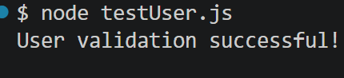
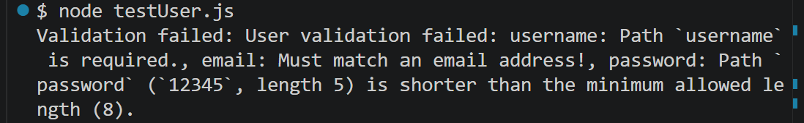

## Introduction

 Lesson 1: 
 **Foundations of Web Authentication & Password Security**. 
 
 The goal is to learn how to securely handle user information by creating a Mongoose User model, defining validation rules, and understanding how Mongoose checks user data against those rules. We will also learn how to hash and verify passwords using bcrypt.

 1.  User Model Validation — Passing Test
We provided valid username, email, and password values.

2. User Model Validation — Failing Test (Invalid Input)
